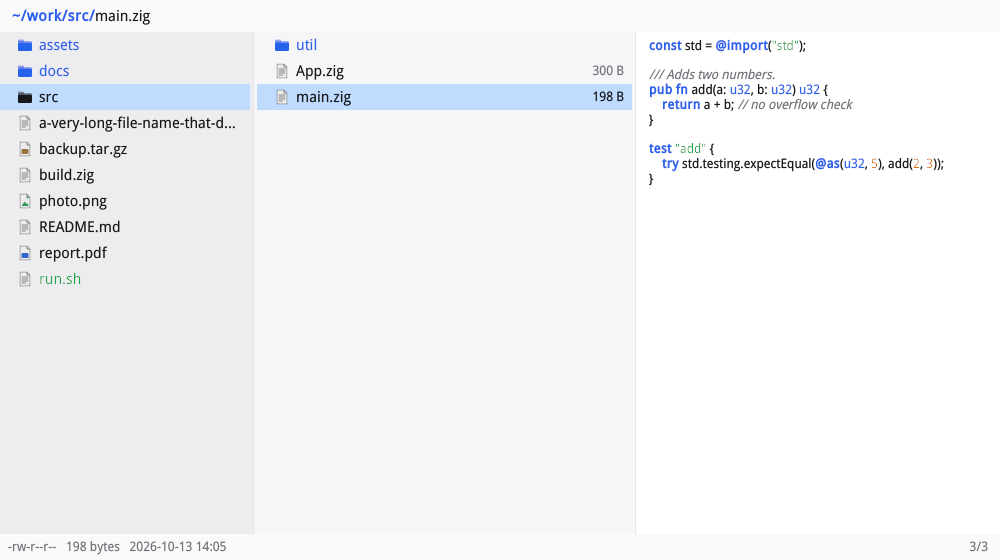
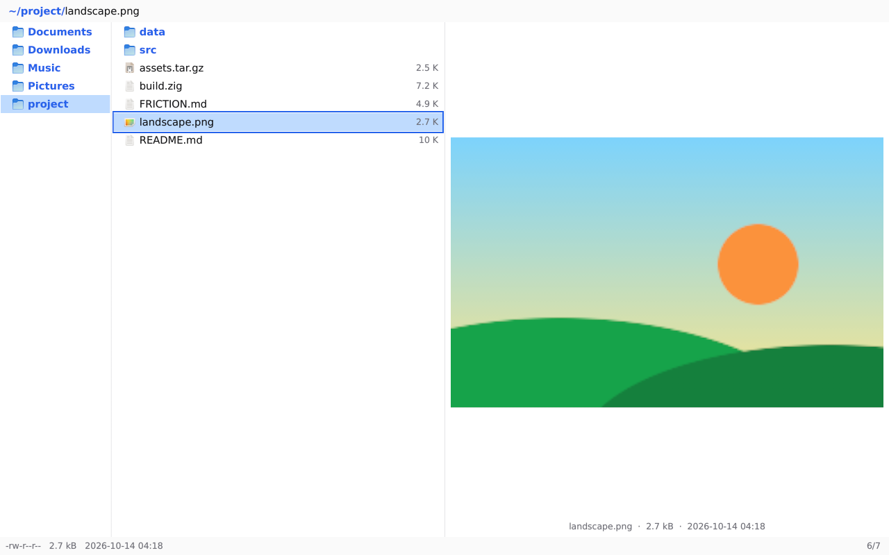
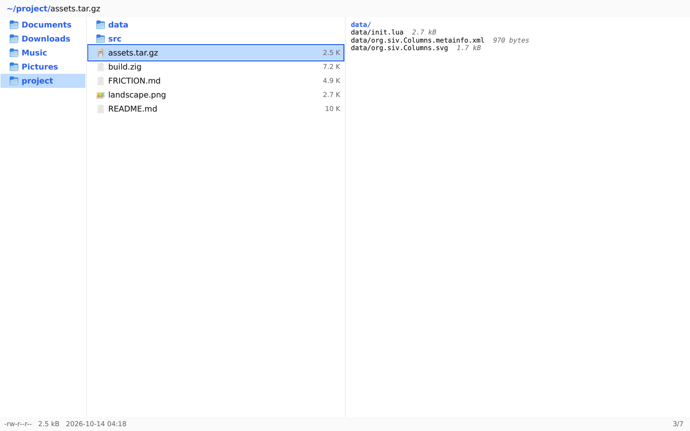
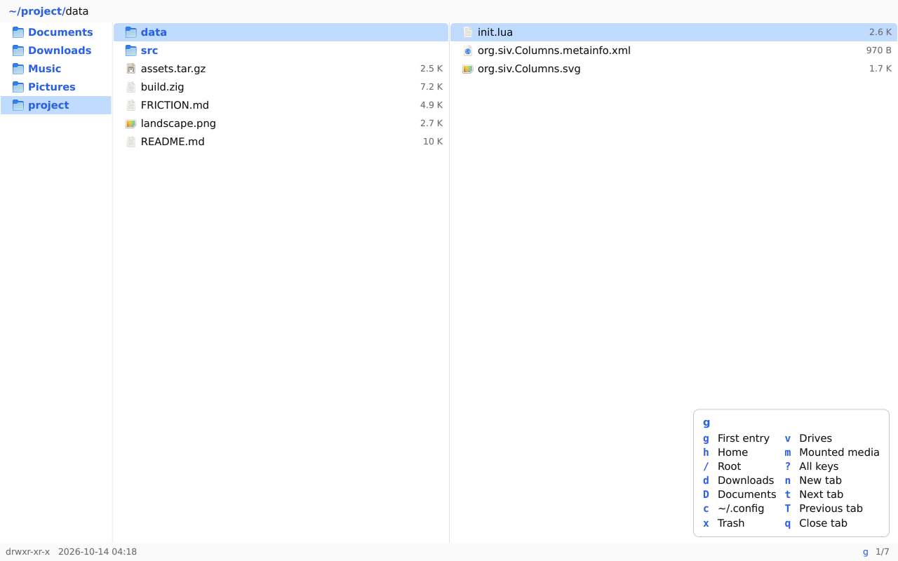
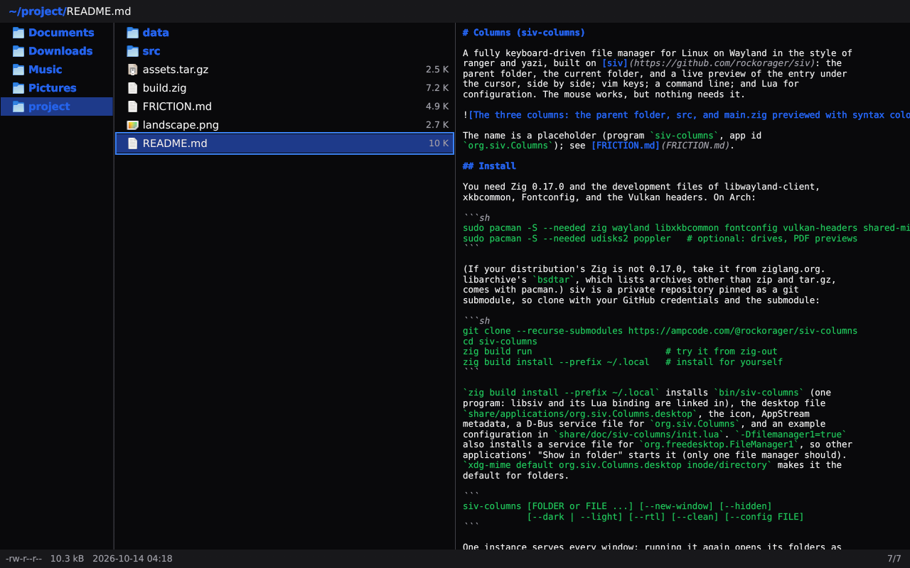
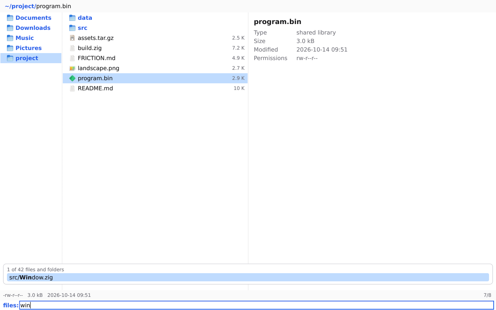
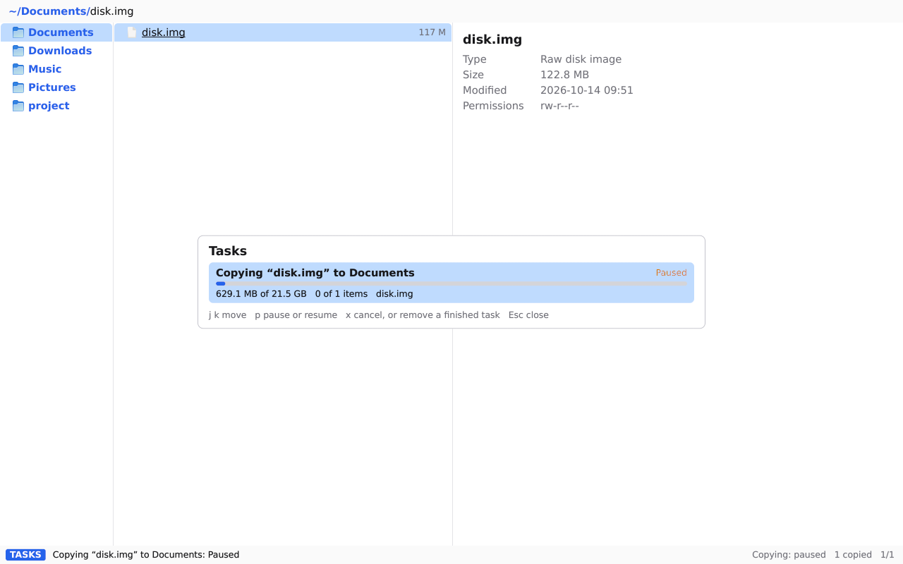
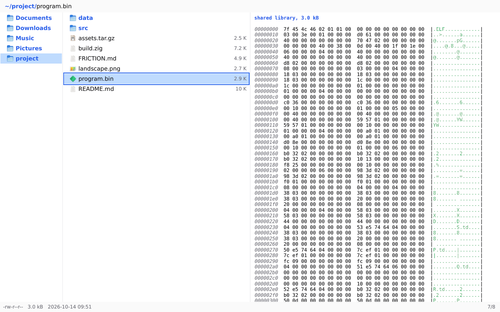

# Columns (siv-columns)

A fully keyboard-driven file manager for Linux on Wayland in the style of
ranger and yazi, built on [siv](https://github.com/rockorager/siv): the
parent folder, the current folder, and a live preview of the entry under
the cursor, side by side; vim keys; a command line; and Lua for
configuration. The mouse works, but nothing needs it.



The name is a placeholder (program `siv-columns`, app id
`org.siv.Columns`); see [FRICTION.md](FRICTION.md).

## Design principle

The best of the terminal with the affordances of a GUI. From the
terminal: keyboard first, modal, scriptable (every action is a named
command, configured in Lua), dense, and fast. From the GUI: what a
window can offer that a terminal cannot, where it helps, such as column
boundaries you can drag, a resize cursor that says so, and surfaces that
tell the columns apart. Neither half gives way to the other: everything
the mouse or a visual cue does has a key and a command, and the keys
never wait for the pointer.

On sway (headless, 1280×800, driven with wtype): an image previewed at
its displayed size, an archive listing, the which-key popup after `g`,
the dark style with a syntax-colored README, the fuzzy finder (`gf`), a
copy paused in the tasks view (`w`), and a program in hex.

| | |
| --- | --- |
|  |  |
|  |  |
|  |  |
|  | |

## Install

You need Zig 0.17.0 and the development files of libwayland-client,
xkbcommon, Fontconfig, and the Vulkan headers. On Arch:

```sh
sudo pacman -S --needed zig wayland libxkbcommon fontconfig vulkan-headers shared-mime-info
sudo pacman -S --needed udisks2 poppler   # optional: drives, PDF previews
```

(If your distribution's Zig is not 0.17.0, take it from ziglang.org.
libarchive's `bsdtar`, which lists archives other than zip and tar.gz,
comes with pacman.) siv is a private repository pinned as a git
submodule, so clone with your GitHub credentials and the submodule:

```sh
git clone --recurse-submodules https://ampcode.com/@rockorager/siv-columns
cd siv-columns
zig build run                         # try it from zig-out
zig build install --prefix ~/.local   # install for yourself
```

`zig build install --prefix ~/.local` installs `bin/siv-columns` (one
program: libsiv and its Lua binding are linked in), the desktop file
`share/applications/org.siv.Columns.desktop`, the icon, AppStream
metadata, a D-Bus service file for `org.siv.Columns`, and an example
configuration in `share/doc/siv-columns/init.lua`. `-Dfilemanager1=true`
also installs a service file for `org.freedesktop.FileManager1`, so other
applications' "Show in folder" starts it (only one file manager should).
`xdg-mime default org.siv.Columns.desktop inode/directory` makes it the
default for folders.

```
siv-columns [FOLDER or FILE ...] [--new-window] [--hidden]
            [--dark | --light] [--rtl] [--clean] [--config FILE]
```

One instance serves every window: running it again opens its folders as
tabs in the running one. A file on the command line is shown under the
cursor in its folder; from a terminal it starts in the terminal's folder.

## Keys

`g?` or F1 lists every binding and command in the preview column. After a
prefix (`g`, `s`, `d`, `y`, `z`, `'`, `m`) a popup shows what can follow.
Counts work where they make sense: `5j`, `3H`, `2u`; `10G` goes to the
tenth entry.

| Keys | |
| --- | --- |
| `j` `k` `h` `l`, arrows | down, up, the parent folder, enter or open |
| `gg` `G`, `Ctrl+d` `Ctrl+u`, `Ctrl+f` `Ctrl+b` | first, last, half pages, pages |
| `H` `L` | back and forward in the tab's history |
| `Enter`, `o` | open with the default application (mimeapps.list), open with… |
| `/` `?` `n` `N` | search forward and backward as you type, next, previous |
| `f` | jump by typing part of a name |
| `zf` | filter the folder as you type (Enter keeps it, Esc drops it) |
| `Space`, `v`, `Ctrl+a`, `Esc` | mark and move down, visual selection, mark all, cancel and unmark |
| `yy` `dd` `p` `P` | copy, cut, paste, paste replacing |
| `yp` `yn` `yd` | copy the paths, the names, the folder's path |
| `dT` `Del`, `dD` `Shift+Del`, `u` | move to the trash, delete permanently (a dialog asks), undo |
| `r` `A` `I`, `R` | rename (the name without its extension selected, at the end, at the start), bulk rename in `$EDITOR` |
| `a` | new file, or folder with a trailing `/` (`a/b/c/` makes them all) |
| `zh`, `zp`, `zi` | hidden files, the preview, icons |
| `sn` `ss` `sm` `st` `se`, `sr` `sd` | sort by name, size, modified, type, extension; reverse; folders first |
| `m` + key, `'` + key, `''`, `dm` + key | set a bookmark, go to one, back, remove one |
| `gh` `g/` `gd` `gD` `gc` `gm` | home, root, Downloads, Documents, ~/.config, mounted media |
| `gf` | find a file or folder below, fuzzily (`:fuzzy`) |
| `gz`, `:z words` | jump to a folder zoxide knows: pick one, or its best for the words |
| `gx`, `dr` | the trash, restore from it |
| `gv` | drives: open, mount (asks for LUKS passphrases), with `:unmount` and `:eject` |
| `gn` `Ctrl+t`, `gt` `gT` `Tab`, `Alt+1`…`9`, `gq` `Ctrl+w` | tabs: new, next and previous, by number, close |
| `!`, `S` | run a shell command on the selection, a terminal here |
| `=` | change permissions (`:chmod`); `:chown` changes owners |
| `w` | the tasks view: running and recent file operations |
| Menu key, `Shift+F10`, right click | the context menu |
| `Alt+Enter` | properties: details, permissions, owner |
| `>` `<`, `z=` | widen and narrow the current column, back to the ratio |
| `J` `K` | scroll the preview |
| `:` | the command line: Tab completes commands and paths, Up and Down recall history |
| `q`, `ZZ` | close the tab (the window with the last), quit |

What commands act on: the visual range, else the marked entries, else the
entry under the cursor. Copies and cuts go to the clipboard too (as GNOME
and KDE file managers put them), and `p` pastes what other file managers
copied. Files drag out of the current column, and drop into it or onto a
folder's row.

Filters (`zf`) and searches (`/`, `?`) are separate: a filter hides what
does not match until Esc, a search moves the cursor among what is shown.
Both use smart case: a word with a capital letter matches its case, and
the filter wants every space-separated word.

`:chmod` takes what chmod(1) takes: octal (`755`) or symbolic clauses
(`u+x`, `go-w`, `a=rX`); `:chown` takes `user`, `user:group`, or
`:group`, by name or number. `-R` goes into folders. Both run as file
operations, with progress, and work on the visual range, the marked
entries, or the entry under the cursor.

`gf` lists every file and folder below the current folder (read on a
worker, breadth first, without hidden ones unless they are shown, never
.git, up to 200 000) and ranks them as you type, fzf-style: each word's
letters in order, best at word starts, after slashes, in runs, and in
the base name; smart case. Up, Down, Tab, Ctrl+N, and Ctrl+P move; Enter
opens a folder or shows a file in its folder; Esc leaves. With zoxide
installed, every folder visited is added to its database (`zoxide add`,
off the UI thread), `gz` (`:zi`) picks from its folders the same way,
and `:z words` jumps to its best match.

The tasks view (`w`, `:tasks`) lists running file operations with their
progress, bytes, items, and current file, then the last 20 finished ones
with what came of them. In it, `j` and `k` move, `p` or Space pauses and
resumes (the operation stops at its next file or 4 MiB chunk), `x` or
`dd` cancels a running one or takes a finished one off the list, and
Esc, `q`, or `w` closes it. Its keys are a keymap mode of their own
(`t` in `fm.map`), and `:task-pause` and `:task-cancel` act on the first
running operation with the view closed.

Right-clicking an entry, the selection, or a column's empty space (or
pressing the Menu key or Shift+F10 for the cursor's row) opens a menu of
what applies, each item a command with its keys beside it, so the menu
teaches the keymap; commands from init.lua are in a submenu of their
own. A right click outside the selection moves the cursor and drops the
marks, as in other file managers.

Dialogs come up where a dialog beats the status line, and work from the
keyboard: each button and check box has an underlined key that presses
it (with Alt while typing in a field), Enter takes the default, Escape
cancels.
- Deleting permanently and emptying the trash, which cannot be undone.
- A name already taken in an operation of several items or a folder:
  both files compared, replace, skip, keep both, or merge, and a check
  box for every later conflict. A single file's conflict is a one-key
  question in the status line: `r`, `s`, `k`, `m`, `c`, Shift for all.
- Properties (`Alt+Enter`, `:properties`): the details, the mode typed
  as chmod takes it or ticked in check boxes, and the owner, applied as
  chmod and chown operations, into folders on request.

Messages go to the status line, as in ranger and vim, never a dialog or
a toast; errors are in the error color. A message stays until the next key, and `:messages` lists
the last 200 in the preview column, newest first.

## Previews

Folders show their entries; text files their start with syntax coloring
(Zig, C and C++, Rust, Go, Python, JavaScript and TypeScript, Lua, shell,
JSON, TOML, YAML, Markdown, diffs, and more); images decode on siv's
workers at the size the column shows them; archives list their entries
(zip and its relatives, tar and tar.gz directly, others with `bsdtar`);
PDFs show their first page (poppler's `pdftoppm`, else MuPDF's `mutool`,
else a thumbnail another program cached); videos a frame
(`ffmpegthumbnailer`, else `ffmpeg`, else a cached thumbnail); binary
files, and programs and other application data, their first 1 KiB in
hex under their type and size; other files their details, with a link's
target. When a program is missing the details say what to install.

Limits: text previews read `preview_max_bytes` (128 KiB); images larger
than `preview_max_image_bytes` (64 MiB) show their details; programs a
preview runs (renderers, thumbnailers, Lua previewers) are killed after
15 seconds or as soon as the cursor moves on. Pipes, sockets, and devices
are never opened.

A preview starts the moment the cursor lands, and moving on cancels it.
Nothing that previews or navigates touches the file system on the UI
thread: folders are read, watched, and looked up (`:cd`) on workers, so
a slow or hung network file system shows "Loading…" or "Waiting for the
file system…" instead of freezing the keys. At most two file previews run
at once, so previews stuck on a hung mount cannot take the workers that
read folders.

## Configuration

`$XDG_CONFIG_HOME/siv-columns/init.lua` (`~/.config/siv-columns/init.lua`)
runs at startup in Lua 5.5, through siv's Lua binding. Nothing is
required; [data/init.lua](data/init.lua) is an annotated example.

```lua
local fm = require("fm")

fm.set { hidden = true, ratio = { 1, 3, 4 }, sort = "modified", sort_reverse = true }
fm.opt.scroll_off = 5

fm.map("n", "gp", "cd ~/Projects", "Projects")          -- keys run commands…
fm.map({ "n", "v" }, "<C-c>", "yank", "Copy")
fm.map("n", "gi", function(count)                         -- …or Lua functions
	fm.notify(#fm.selected() .. " targets")
end, "Count the targets")
fm.unmap("n", "dD")

fm.command("archive", function(args, count)               -- :archive name.tar.gz
	fm.exec("shell tar -czf " .. ("%q"):format(args) .. ' "$@"')
end, "Pack the targets")

fm.previewer { name = "*.csv", run = function(path, mime) return "…" end }
fm.previewer { mime = "video/*", cmd = { "mediainfo", "%s" } }

fm.on("cd", function(path) end)
fm.bookmark("p", os.getenv("HOME") .. "/Projects")

-- siv itself: timers, jobs, notifications, D-Bus…, on the running app.
local app = fm.siv_app()
app:timer_start(1000, function() fm.notify("a second later") end)
```

Modes for `fm.map` and `:map` are `n` (normal), `v` (visual), and `t`
(the tasks view). `fm` also has `get`, `cwd`, `hovered`, `selected`, `cd`, `exec` (any
command line), `notify`, and `siv_window`. Every option is also `:set
name value` while running (`:set hidden!` toggles); `:map` and `:unmap`
bind keys, `:lua` runs Lua. Options: `hidden`, `sort`, `sort_reverse`,
`dirs_first` (on by default), `ratio`, `fit_parent`, `narrow_width`, `icons`, `preview`, `preview_images`,
`preview_max_bytes`, `syntax`, `which_key_delay`, `scroll_off`,
`wrap_scan`, `find_auto_accept`, `confirm_delete`, `show_size`,
`terminal`, `editor`, `editor_in_terminal`, `shell`, `stale_ms` (how
old a folder that cannot be watched, such as the trash, may be before
it is read again; watched folders follow changes on disk at once).

Drag the boundary between two columns to resize them (the pointer turns
into a resize arrow over it), or press `>` and `<` (32 px, counts
multiply; `:column-wider parent` and `:column-narrower parent` for the
parent); room comes from the preview, and no column gets narrower than
80 px. Chosen widths are shares of the window, win over `ratio` and
`fit_parent` until `z=` (`:column-reset`), still give way to
`narrow_width`, and are kept in `$XDG_STATE_HOME/siv-columns/columns`.

Column widths start from `ratio`, the shares of the parent, current, and
preview columns (ranger's `column_ratios`; 0 hides a column). With
`fit_parent` (on) the parent column widens to show its longest name, up
to a quarter of the window, taking the room from the preview. A window
narrower than `narrow_width` (640 logical pixels) hides the parent
column, and one narrower than two thirds of that the preview too.

Bookmarks and the command history persist in
`$XDG_STATE_HOME/siv-columns/`.

## Desktop integration

- Light, dark, and high-contrast styles and the accent follow the desktop
  (every color is a siv theme token, syntax colors included); right to
  left layouts mirror the columns.
- Screen readers: the columns are lists whose focused row is the cursor,
  marked entries say so, the status line is a live region, prompts are
  labeled text fields (AT-SPI, through siv).
- Opening uses the desktop's MIME defaults (mimeapps.list); `o` offers
  every application for the type.
- Drives come from UDisks2: mount (polkit asks if it must), unmount,
  eject, and unlock encrypted volumes with a passphrase typed in a masked
  field.
- Other applications' "Show in folder" (org.freedesktop.FileManager1)
  opens the item under the cursor in a tab.
- The trash: browse every trash with `gx`, restore with `dr`,
  `:empty-trash`.

## Develop

```sh
zig build test                        # unit tests, and the app on siv's headless backend
SIV_UPDATE_GOLDEN=1 zig build test    # accept new golden images (tests/golden)
zig build bench                       # startup, memory, and navigating 100 000 entries
```

The headless tests drive the application through siv's public test API
— keys typed as a user types them, settling, captures compared with
golden images, and the semantics tree a screen reader reads — with the
test fonts in `tests/fonts` and the MIME and application data in
`tests/data`.

`deps/siv` pins siv. To move to a newer siv: `git -C deps/siv pull
origin main`, run the tests, and commit the submodule. Things siv could
do better, and decisions left to its author, are in
[FRICTION.md](FRICTION.md).

## Performance

`zig build bench` (ReleaseSafe, siv's headless backend with the system's
fonts, warm caches; a 4-core 2.6 GHz Xeon orb, October 2026):

| Measurement | Result |
| --- | --- |
| Startup to the first frame showing a 40-entry folder (its rows included) | 23 ms (UI thread CPU 12 ms) |
| The same with the example `data/init.lua` loaded | 18 ms |
| Resident memory with that window open | 36 MiB (heap in use 19.8 MiB) |
| Idle for 2 s | no wakeups |
| A 100 100-entry folder: read, typed, and sorted | 248 ms, rows shown at 252 ms; the first frame at 18 ms |
| Memory for those entries | 8.3 MiB of heap (87 bytes each); 64 MiB resident in all |
| `j`, 300 times, each frame presented and the preview updated | 0.89 ms UI thread CPU per key (4.3 ms worst, a hex view), each on the next 60 Hz frame |
| 100 `j`s queued at once (a held key) | 15 ms UI thread CPU in all |
| `G`, `gg` | 1.7 ms each |
| `Ctrl+f` (a page) | 1.3 ms (1.7 ms worst) |
| `/file-99999` typed, every keystroke searching all names | 23 ms for the eleven keystrokes |
| `n` (the next match, wrapping around) | 11 ms |
| `h` to the parent and `l` back in (both folders cached and watched) | 4.2 ms |
| `Ctrl+a` marking all 100 100 | 1.6 ms |
| `sS` (by size, largest first, the cursor kept on its entry), `sn` | 68 ms, 86 ms |
| `zf-12` typed (filtering as you type) | 22 ms for the three keystrokes |
| `gf`: the picker, every one of the 100 100 entries walked | 52 ms (17 ms UI thread CPU) |
| `f9999` typed in it, every keystroke scoring the candidates | 30 ms for the five keystrokes |
| Peak memory | 86 MiB |

Rows are virtualized by siv's views, so a frame costs what is on screen,
not what is in the folder.

## License

MIT. siv and what it contains: `share/licenses/siv-columns/`.
