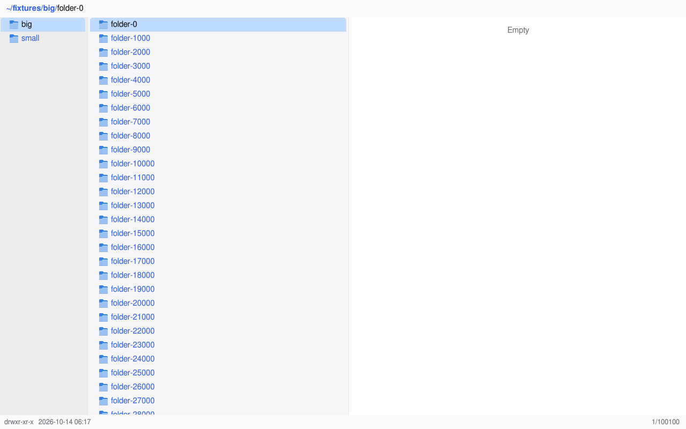
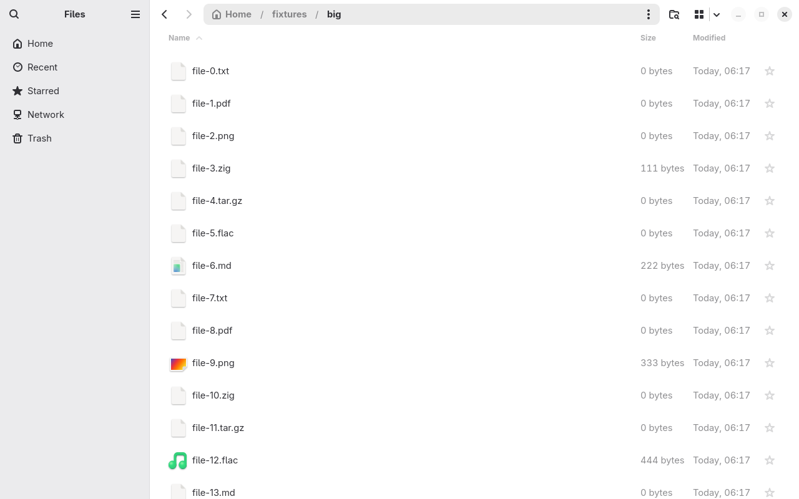

# siv-columns against GNOME Files

siv-columns and Nautilus measured the same way, from outside both
programs, on a real sway session on the GPU of one laptop: what a user
waits for (startup, opening a 100 100-entry folder, keys, scrolling,
filtering) and what the program costs (memory, CPU, idle wakeups).
Unlike `zig build bench` (siv's headless backend, inside the program),
these numbers include the compositor, the GPU, vblank, and the disk.

```text
bench/
  fixtures.py   the folders: small/ (40 entries) and big/ (100 100)
  run.py        runs the sessions, writes raw/<app>-<run>.json
  report.py     the table below, from raw/
  presshim.c    LD_PRELOAD: presentation feedback for every commit (from siv's bench/gpui-compare)
  inject.c      virtual keyboard and pointer (from siv's bench/gpui-compare, more keys)
  capture.c     the screen, frame by frame (ext-image-copy-capture-v1)
  raw/          the measurements behind the results below
```

## Running

```sh
sudo pacman -S --needed nautilus sway grim python-numpy
zig build -Doptimize=ReleaseFast install --prefix /opt/siv-columns
make -C bench                                   # the three tools, into bench/out
sudo useradd -m fmbench                         # Nautilus refuses to run as root
sudo python3 bench/fixtures.py /home/fmbench/fixtures && sudo chown -R fmbench: /home/fmbench/fixtures
sudo python3 bench/run.py --runs 5              # about 18 minutes; stop other sway sessions first
python3 bench/report.py
```

`run.py` runs sway on the KMS device `/dev/dri/card1` (`--backend
headless` for a machine without a panel), drops the page cache for the
cold start, and runs the file managers as `--user` (`fmbench`).
`BENCH_COLUMNS` names another siv-columns binary. `--screenshots DIR`
and `--keep-captures DIR` keep what the first run saw.

## Method

**The machine.** AMD Ryzen 5 PRO 7640HS with a Radeon 760M (RADV, Mesa
26.2.2), 30 GiB, Linux 7.2.2, `powersave` with `balance_performance`,
btrfs on NVMe. Nothing else heavy ran; every result records the load
average.

**The session.** Each run of each app starts a fresh sway 1.12 (wlroots
0.20.2) on its DRM backend, driving the laptop's eDP panel in its
1280×800 mode at 60.003 Hz, scale 1, with the Vulkan renderer and no
borders, so the one tiled window is 1280×800 and frames reach the panel
at real vblanks: every latency includes waiting for the next one (up to
16.7 ms). Then a private session bus for the user, with GVfs already
running, then the app.

**The apps.** siv-columns e022a62 (siv 4a7c551), built ReleaseFast,
rendering with Vulkan on the 760M (its log says so), `--light`. Nautilus
50.3 (GTK 4.22.4, libadwaita 1.9.3), rendering with GSK's Vulkan
renderer (its process maps RADV), light by default, in its list view
(`default-folder-viewer='list-view'`; its default is the grid, which no
one compares with a list), everything else default. Both run as the same
unprivileged user with the same environment (`LANG=C.UTF-8`,
`XDG_SESSION_TYPE=wayland`), the same fixture folders, and the same
pointer position.

**Services.** GVfs (gvfsd, gvfsd-metadata, the UDisks2 volume monitor)
is started on the bus before either app, as a GNOME session has it;
Nautilus then starts gvfsd-trash, -recent, and -network. These are not
counted in Nautilus's memory or CPU; their memory is given beside the
table (siv-columns does not use them). LocalSearch (Tracker) is not on
the bus: it is the desktop's indexer and runs whatever file manager is
open, its first crawl of the home folder would load the machine during
the measurements, and the fixture folders are outside the folders it
indexes by default, so Nautilus searches them with its own engine either
way. Neither app gets an accessibility bus or portals (both would
publish AT-SPI trees and read desktop settings through them).

**The folders** (`fixtures.py`, in the user's home). `small/`: 8
folders and 32 files. `big/`: 100 000 files `file-0` … `file-99999` in
seven extensions, every third with a sparse size, and 100 folders: the
folder of `tests/bench.zig`.

**Instruments**, the same for both:

- **Frames**: `presshim.so`, preloaded, asks for `wp_presentation`
  feedback on every `wl_surface.commit` (as siv's gpui comparison does).
  First frame is from `fork` to the presentation of the toplevel's first
  frame; key to photon is from the moment `inject` flushed the key to
  sway to the presentation of the app's first commit after it.
- **Pixels**: `capture` copies the output (ext-image-copy-capture-v1)
  each time it changes and keeps the darkest luma of each 4×4 block, so
  text survives. *Rows on screen* is the first frame whose row area (the
  middle column of siv-columns; Nautilus's list below its column
  headers) holds at least half the text pixels of the final frame and
  has changed at least half as much as the final frame has, so a moved
  cursor in the old folder does not count; *settled* is when the row
  area stopped changing (icons, sizes, sorting, a "Loading…" spinner).
  Each captured frame is dated by the vblank it was shown at (the app's
  presentation at or after sway's commit). Captures run only during
  startup, opening, and filtering.
- **Input**: `inject`, a virtual keyboard and pointer through sway's
  seat.
- **/proc**: CPU time from every thread's `schedstat`; wakeups are
  voluntary and involuntary context switches per second over 10 s
  (threads that exit keep their last sample); RSS and PSS
  (`smaps_rollup`) of the app, and PSS with its child processes
  (Nautilus's sandboxed glycin image loaders); GPU memory is the app's
  `drm-memory-vram` plus `drm-memory-gtt`.

**Each run**, apps alternating, five runs:

1. Drop the page cache; start the app on `small/` (cold start); type the
   path of `big/` (siv-columns `:cd PATH`, Nautilus Ctrl+L PATH) and
   press Enter with its metadata still cold; quit.
2. Start again (warm start); memory; 10 s idle.
3. Stat every entry of `big/` (warm metadata), open it the same way;
   memory; 10 s idle.
4. Down ×20 at 4/s; Down held (60 presses at 30/s, a key repeat); Page
   Down ×10; End and Home ×5 each; touchpad scrolling under the pointer
   (30 px events at 120/s for 5 s); 15 wheel notches.
5. Home, then type `12345` at 150 ms per key: siv-columns filters with
   `zf`, Nautilus starts its search by typing. One entry matches.

## Results

Measured 2026-10-14 with the commits above. `raw/` has every run;
`report.py` makes this table from it. Times are from the key press (or
`fork`) to the photon.

Median (worst); 5 runs of siv-columns, 5 runs of Nautilus. These runs
predate siv 66cdcfc and cb24e9b, which removed 16 MiB and 8 MiB of
siv-columns's GPU memory; see **GPU memory** below for three runs with
them.

| Measurement | siv-columns | Nautilus |
| --- | --- | --- |
| Cold start (page cache dropped): first frame, ms | 116 (121) | 415 (425) |
| Cold start: rows on screen, ms | 116 (121) | 498 (508) |
| Cold start: settled (icons, sizes), ms | 143 (155) | 582 (598) |
| Warm start: first frame, ms | 48 (51) | 176 (180) |
| Warm start: rows on screen, ms | 48 (51) | 228 (231) |
| Warm start: settled, ms | 81 (84) | 341 (347) |
| Memory after start: RSS, MiB | 61 (61) | 106 (107) |
| Memory after start: PSS, MiB (with child processes) | 43 (43) | 82 (83) |
| Memory after start: GPU (VRAM + GTT), MiB | 47 (47) | 30 (30) |
| Idle 10 s after start: wakeups/s | 0.0 (0.0) | 0.6 (0.6) |
| Open 100 100 entries, cold: rows on screen, ms | 809 (832) | 4803 (4941) |
| Open 100 100 entries, cold: settled, ms | 809 (832) | 4803 (4941) |
| Open 100 100 entries, warm: rows on screen, ms | 157 (167) | 3426 (3496) |
| Open 100 100 entries, warm: settled, ms | 157 (167) | 3426 (3496) |
| Open 100 100 entries, warm: CPU time, ms | 146 (151) | 4177 (4250) |
| Memory with 100 100 entries: RSS, MiB | 68 (70) | 288 (292) |
| Memory with 100 100 entries: PSS, MiB (with child processes) | 50 (51) | 263 (268) |
| Idle 10 s with 100 100 entries: wakeups/s | 0.2 (0.3) | 97.7 (98.0) |
| Idle 10 s with 100 100 entries: CPU, % | 0.00 (0.00) | 0.28 (0.28) |
| Down, key to photon, ms (100 presses) | 12.0 (21.4) | 13.3 (46.0) |
| Down held (30/s for 2 s), key to photon, ms | 20.5 (34.0) | 38.5 (46.9) |
| Down held: CPU per frame, ms | 1.23 (1.26) | 4.32 (4.44) |
| Down held: dropped frames | 0 (0) | 0 (0) |
| Page Down, key to photon, ms | 10.9 (31.1) | 21.6 (28.9) |
| End, key to photon, ms | 12.4 (21.7) | 44.2 (56.5) |
| Home, key to photon, ms | 11.9 (20.3) | 72.0 (77.9) |
| Touchpad scroll (5 s): frames presented | 302 (302) | 302 (302) |
| Touchpad scroll: dropped frames | 0 (0) | 0 (0) |
| Touchpad scroll: worst frame interval, ms | 16.7 (16.7) | 16.7 (16.7) |
| Touchpad scroll: CPU per frame, ms | 1.51 (1.55) | 5.75 (6.08) |
| Wheel notch to photon, ms | 9.0 (29.3) | 20.9 (27.2) |
| Filter "12345" typed: each key to photon, ms | 13.3 (25.9) | 408.1 (719.7) |
| Filter: last key to final result on screen, ms | 13 (15) | 1771 (1796) |
| Filter: CPU time while typing, ms | 28 (30) | 1690 (1721) |
| Memory at the end: RSS, MiB | 81 (82) | 321 (322) |

GVfs services after Nautilus started (gvfs-udisks2-vo, gvfsd, gvfsd-fuse, gvfsd-metadata, gvfsd-network, gvfsd-recent, gvfsd-trash): PSS 18.5 MiB (median), idle wakeups 0.0/s.

| | |
| --- | --- |
|  |  |

What the numbers say:

- **Startup.** siv-columns's first frame already has the folder's rows,
  4× sooner than Nautilus shows its rows, cold or warm.
- **The 100 100-entry folder.** Nautilus shows an empty list with a
  "Loading…" spinner until every entry is in, then all rows at once:
  3.4 s warm (4.2 s of CPU), 4.8 s cold. siv-columns shows "Loading…"
  within two frames and its rows, sorted, at 157 ms warm and 0.8 s cold
  (the difference is btrfs reading the metadata). Nautilus then holds
  288 MiB to siv-columns's 68 MiB.
- **Keys.** Both answer a single Down on the next vblank or the one
  after (medians 12 and 13 ms), but Nautilus's slow cases are slower
  (46 ms worst), and End and Home take it 3 to 5 frames. With the key
  held, Nautilus answers in 2+ frames to siv-columns's 1+, at 3.5× the
  CPU per frame. Neither dropped a frame scrolling or holding a key.
- **Filtering.** siv-columns's filter shows the match on the frame
  after each key (13 ms). Nautilus's search echoes each typed character
  0.4 to 0.7 s late and settles on the one result 1.8 s after the last
  key.
- **Idle.** siv-columns makes no wakeups after starting and one every
  5 s in the big folder. Nautilus's main thread wakes 98 times a second
  while idle in the big folder (0.3% CPU), for as long as it shows it.
- **GPU memory** is the one count where siv-columns is higher: 47 MiB
  after starting (Nautilus 30), of which 43 MiB is VRAM. In the runs
  above it then went to 63 MiB (VRAM 43 → 59 MiB; Nautilus 25 → 27) and
  stayed there through scrolling and filtering (Nautilus ends at
  51 MiB). The folder did not cause that step. siv's Vulkan renderer
  made every path mask page at least 2048 px square, with two layers
  for each frame in flight, and the first paths siv-columns draws are
  the four bands of the command line's border. The command line opens
  as `:cd` is typed, just before the folder opens. siv 66cdcfc sizes the
  pages to the frame's masks. With it (siv-columns 5962120, 3 runs,
  `raw/siv-66cdcfc/`) siv-columns holds 46.9 MiB after starting and
  48.2 MiB with the big folder open, against 63.0 MiB for the same app
  with siv cdfb9be. siv cb24e9b then makes each glyph atlas with its
  first glyph, and siv-columns draws no color glyphs, so the 8 MiB color
  atlas is never made. With it (3 runs, `raw/siv-cb24e9b/`) siv-columns
  holds **38.9 MiB after starting and 40.2 MiB with the big folder
  open**. The other numbers in all these runs matched the table within
  noise.

  Where the rest goes, of 38.9 MiB at the start: five swapchain images
  of 4.4 MiB (22 MiB; Mesa's minimum for MAILBOX is four, and siv asks
  for one more), the FP16 working image siv composites in (8.2 MiB),
  the 2048 px glyph mask atlas (4 MiB), about 1 MiB of RADV's own
  buffers, and about 3.5 MiB of GTT (lookup tables, frame data, command
  buffers, page tables). Nautilus has four larger swapchain images
  (19.3 MiB), a 4 MiB atlas, and no FP16 image. Three cuts were left
  out because each costs something: four swapchain images (−4.4 MiB;
  siv skips a frame when the compositor holds every image, which would
  happen more often), an 8-bit working image (−4.1 MiB; loses linear
  FP16 compositing), and a 1024 px mask atlas to start (−3 MiB; a full
  atlas makes siv wait for the GPU and rasterize its glyphs again).

## What is not measured fairly

- **Filter and search are different features.** siv-columns's `zf`
  filters the folder it has loaded; Nautilus's type-ahead starts a
  recursive search with its own engine, after a pause in typing. In a
  flat folder they show the same one match, which is what the table
  compares; the mechanisms differ.
- **The windows show different things.** Nautilus shows 14 rows of
  52 px with a sidebar; siv-columns 28 rows of 26 px in three columns,
  and it also previews the entry under the cursor after each key.
- **Scrolling distance.** Both got the same touchpad events, but GTK
  moves farther per event (Nautilus ended at `file-865`, siv-columns at
  `file-592`): frame pacing and CPU per frame compare, distance does not.
- **Startup of a resident Nautilus.** On a GNOME desktop Nautilus may
  already be running when a window is asked for; this measures a new
  process, as siv-columns is measured.
- **GPU memory** counts what each process allocated through amdgpu;
  the two renderers allocate differently, so read it as a footprint,
  not as equal work.
- **Cold** means the whole page cache dropped while the GVfs services
  kept running (their pages stay mapped); a real first start after
  login can differ.
- **"Rows on screen"** is judged from pixels in a fixed area per app,
  at 4×4-block resolution; it is exact to the frame, not finer.
- **No accessibility bus.** Both would publish an AT-SPI tree with one;
  that cost is not here.
